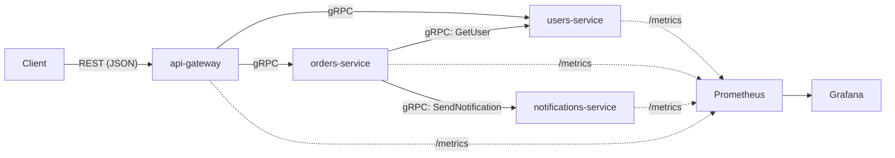

# NestJS gRPC Microservices

[](https://github.com/paulorodriguesdevcode/nestjs-grpc-microservices/actions/workflows/ci.yml)

A small, complete microservices system: three NestJS services talking to each other over gRPC, sitting behind an HTTP API gateway, with structured logs and Prometheus/Grafana metrics — all runnable with one `docker compose up`. Built to demonstrate architecture decisions and trade-offs, not just working code.

## The scenario

An e-commerce-shaped domain, small enough to fit in your head, big enough to need real service boundaries:

- **`users-service`** owns user records.
- **`notifications-service`** simulates sending a notification (email/SMS) — a stand-in for a real provider integration.
- **`orders-service`** owns orders. Creating an order calls `users-service` to validate the user exists, then calls `notifications-service` to fire a confirmation — both as gRPC calls to other services, not local function calls.
- **`api-gateway`** is the only HTTP surface. It has no domain logic of its own — it validates REST input and translates it into gRPC calls against `orders-service` and `users-service`.



## Run it

```bash
docker compose up --build
```

- REST API: `http://localhost:3000` (`POST /users`, `GET /users/:id`, `GET /users`, `POST /orders`, `GET /orders/:id`, `GET /orders?userId=`)
- Prometheus: `http://localhost:9090`
- Grafana: `http://localhost:3300` (anonymous viewer access enabled — a "Microservices Overview" dashboard is provisioned automatically, no setup needed)

Try it:

```bash
USER=$(curl -s -X POST localhost:3000/users \
  -H 'Content-Type: application/json' \
  -d '{"name":"Ana","email":"ana@example.com"}')
echo "$USER"

USER_ID=$(echo "$USER" | node -pe 'JSON.parse(require("fs").readFileSync(0)).id')

curl -s -X POST localhost:3000/orders \
  -H 'Content-Type: application/json' \
  -d "{\"userId\":\"$USER_ID\",\"items\":[{\"productName\":\"Widget\",\"quantity\":2,\"unitPrice\":9.99}]}"
```

Each service also runs standalone for local development (`cd services/<name> && npm install && npm run start:dev`); gRPC target URLs are configurable via env vars (`USERS_SERVICE_URL`, `ORDERS_SERVICE_URL`, `NOTIFICATIONS_SERVICE_URL`), defaulting to `localhost:<port>`.

## Tests

```bash
npm run install:all   # npm ci in every service
npm test              # unit tests for each service, then the end-to-end system test
```

Three layers, each answering a different question:

| Layer | Where | What it proves |
|---|---|---|
| **Unit** | `services/*/src/**/*.spec.ts` | Domain logic and error translation inside one service: an unknown user is `NOT_FOUND`, any other `users-service` failure becomes `UNAVAILABLE`, a failed notification never rolls back an order, the notification failure band is exactly what the code says it is. Downstream gRPC clients are faked at the `ClientGrpc` boundary. |
| **HTTP contract** | `services/api-gateway/src/app.http.spec.ts` | The gateway's promise to REST callers, using the real `AppModule`, `ValidationPipe` and `GrpcExceptionFilter`: invalid bodies are `400` and never reach gRPC, unknown fields are rejected, `NOT_FOUND` is `404`, `UNAVAILABLE` is `503`. |
| **End-to-end** | `e2e/system.test.mjs` | The boundary itself. Spawns all four built services on free ports and drives them only through the gateway — real `.proto` files, real gRPC, `NOT_FOUND` crossing two hops, Prometheus counters actually incrementing. |

Tests use Node's built-in runner (`node:test`) through `ts-node`. NestJS 12 ships as ESM only, which Jest can't load on Node 22 without an extra transform; the built-in runner can, with no test framework to keep in sync. CI ([`.github/workflows/ci.yml`](.github/workflows/ci.yml)) runs typecheck, build and unit tests with coverage per service, then the e2e suite and a `docker compose build`.

## Decisions and trade-offs

### Why gRPC for service-to-service calls, REST at the edge

Internally, calls are contract-first (`.proto` files under [`proto/`](proto/)), binary, and HTTP/2 multiplexed — a real advantage when `orders-service` is making two synchronous calls per request (`GetUser`, then `SendNotification`) and latency compounds. Externally, REST/JSON stays at the gateway because that's what any HTTP client expects, and it's the one boundary that benefits from human-readability and tooling (curl, Postman, browsers). This is the same reason `api-gateway` exists at all: it's the translation layer so internal services never have to speak two protocols.

### Why these specific service boundaries

Three services, split by who owns what data and what changes independently: user identity, order lifecycle, and outbound communication are different concerns with different reasons to change. `orders-service` depending on the other two (rather than a flatter or more circular graph) mirrors the real dependency: you cannot have an order without a user, and a created order is naturally the trigger for a notification. There's no shared database and no service reaches into another's storage — the only contract between them is the `.proto` file.

### Why gRPC status codes are translated at the gateway, not before

A `NOT_FOUND` from `users-service` propagates through `orders-service` unchanged and only becomes an HTTP `404` at the very edge ([`api-gateway/src/filters/grpc-exception.filter.ts`](services/api-gateway/src/filters/grpc-exception.filter.ts)). Translating earlier would mean every internal service needs to know about HTTP, which defeats the point of keeping gRPC internal. One filter, one place, one mapping table.

### Why in-memory storage

Each service keeps its state in a `Map` in process memory — deliberately, to keep the focus on the communication architecture (the actual subject of this repo) rather than on standing up three databases in Docker Compose. This is the trade-off most worth naming explicitly: a real deployment would give each service its own database (classic "database per service"), and the in-memory choice means state doesn't survive a restart and isn't shared across replicas. Swapping the `Map` for a real store is contained entirely inside each service's `*.service.ts` — nothing about the gRPC contracts or the gateway would change.

### Why notification failure doesn't fail the order

`notifications-service` fails ~10% of calls on purpose (see [`notifications.service.ts`](services/notifications-service/src/notifications/notifications.service.ts)) to make the failure path real, not hypothetical. `orders-service` treats it as best-effort: the order is already committed before the notification call happens, and a failed notification is logged, not thrown. Order creation and notification delivery are not one transaction — coupling them would mean a flaky third-party notification provider could block orders from being created, which is the wrong failure mode for this domain.

### Why observability is uniform across all four services

Every service — including the gateway — exposes the same two endpoints (`/health`, `/metrics`) and emits the same JSON log shape (see [`common/logger.ts`](services/users-service/src/common/logger.ts), duplicated per service on purpose — four tiny files, no shared package to version). gRPC services count and time every RPC via a single interceptor ([`common/metrics.ts`](services/users-service/src/common/metrics.ts)); the gateway does the equivalent for HTTP via middleware. The Grafana dashboard is provisioned as code ([`monitoring/grafana/provisioning/`](monitoring/grafana/provisioning/)) so `docker compose up` produces a working dashboard, not an empty Grafana instance waiting to be configured by hand.

## What's here

```
proto/                    Shared .proto contracts (source of truth for all inter-service calls)
services/
  users-service/           gRPC only + /health, /metrics
  notifications-service/    gRPC only + /health, /metrics
  orders-service/          gRPC server + gRPC client (calls users, notifications)
  api-gateway/             REST only + gRPC clients (calls users, orders)
monitoring/
  prometheus/              Scrape config
  grafana/provisioning/     Datasource + dashboard-as-code
docker-compose.yml         Brings up all 4 services + Prometheus + Grafana
e2e/                       End-to-end system test (all services, real gRPC)
.github/workflows/         CI: typecheck, build, unit + coverage, e2e, docker build
```

See [docs/architecture.md](docs/architecture.md) for request-flow and error-handling sequence diagrams.

## What's intentionally not here

No authentication/authorization (every service trusts its caller — a real system would add mTLS or a service mesh between internal services, and JWT/API keys at the gateway). No database. No message queue — every call here is synchronous request/response, which is a trade-off in itself: an async event (`OrderCreated` → a queue → `notifications-service` subscribes) would decouple the two services further and let the gateway return before the notification even attempts to send, at the cost of losing the synchronous "did it send" answer this version gives you.

## License

MIT
