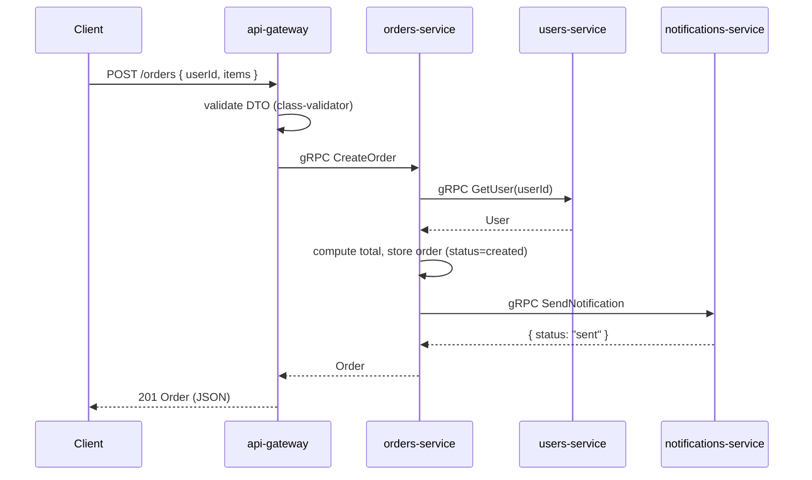
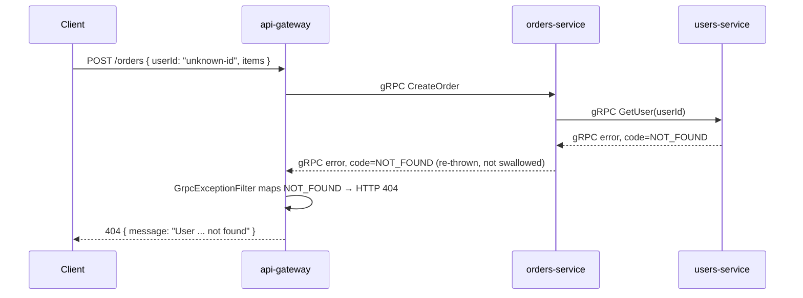
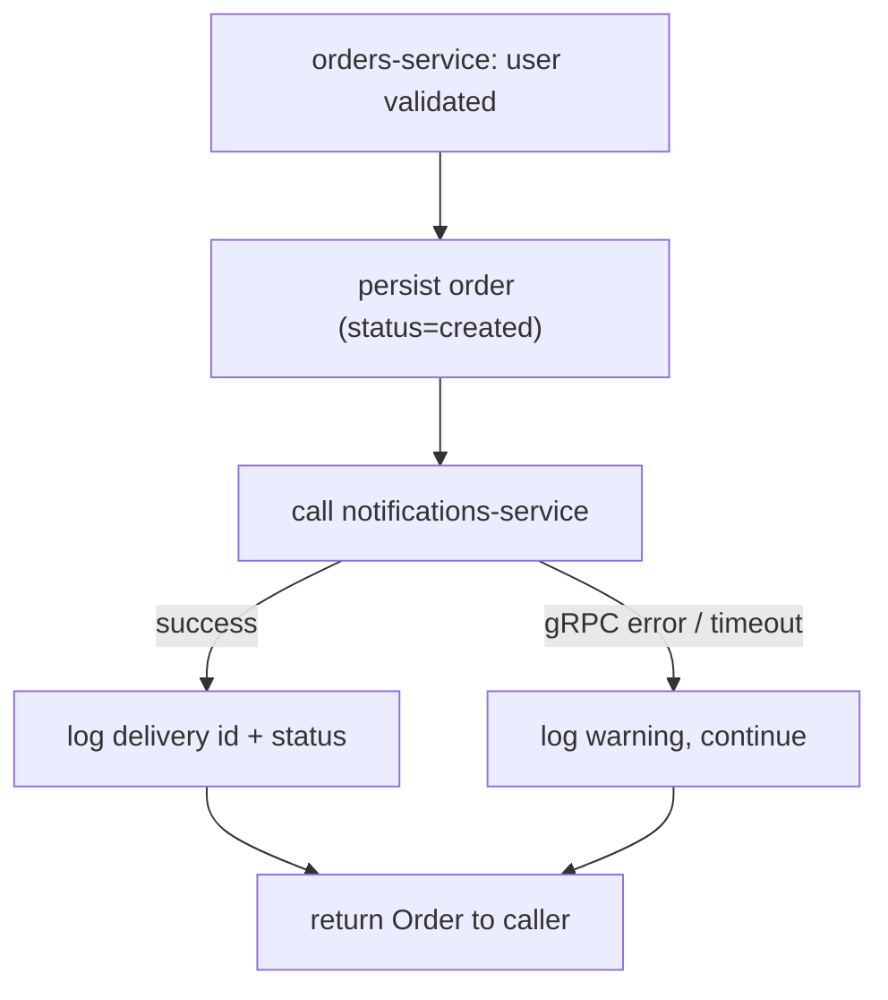
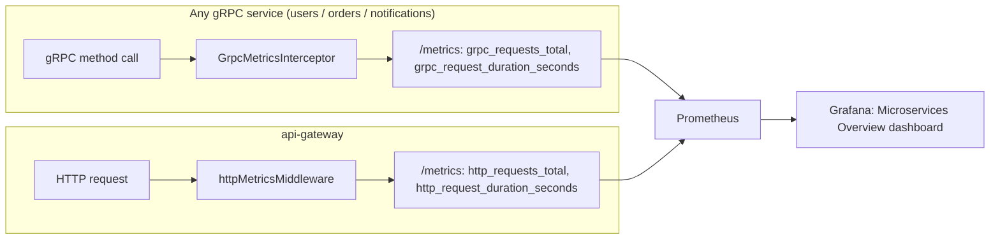
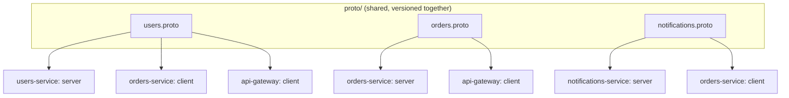

# Architecture Deep Dive

## 1. Happy-path request: creating an order

Two gRPC hops happen inside a single REST request. `orders-service` is a client of two other services and a server to the gateway at the same time — every service in this repo is both, except `api-gateway` (pure client) and the two leaf services (pure servers).

## 2. Error propagation: gRPC status → HTTP status

The `NOT_FOUND` originates two hops away, in `users-service`, and survives unchanged through `orders-service` — nothing in the middle rewrites or loses the error. Every gRPC service in this repo throws `RpcException` with an explicit `@grpc/grpc-js` status code (`NOT_FOUND`, `INVALID_ARGUMENT`, ...); the mapping table lives in exactly one place, [`api-gateway/src/filters/grpc-exception.filter.ts`](../services/api-gateway/src/filters/grpc-exception.filter.ts).

## 3. Best-effort notification: the order doesn't roll back

The order is durable (in this demo, in-memory-durable) before the notification is even attempted. A failed or slow notification never turns into a failed order — see the trade-off discussion in the main [README](../README.md#why-notification-failure-doesnt-fail-the-order).

## 4. Observability: identical shape across services

Every service also emits one JSON log line per event to stdout (service name, level, message, timestamp) — no log aggregator wired up in this demo, but the shape is aggregator-ready as-is.

## 5. Proto contracts as the only coupling

No service imports another service's code. The `.proto` files are the entire contract, copied into each Docker image at build time (see the `Dockerfile` in each service — the image layout deliberately mirrors the monorepo layout so proto path resolution is identical in Docker and local dev).
